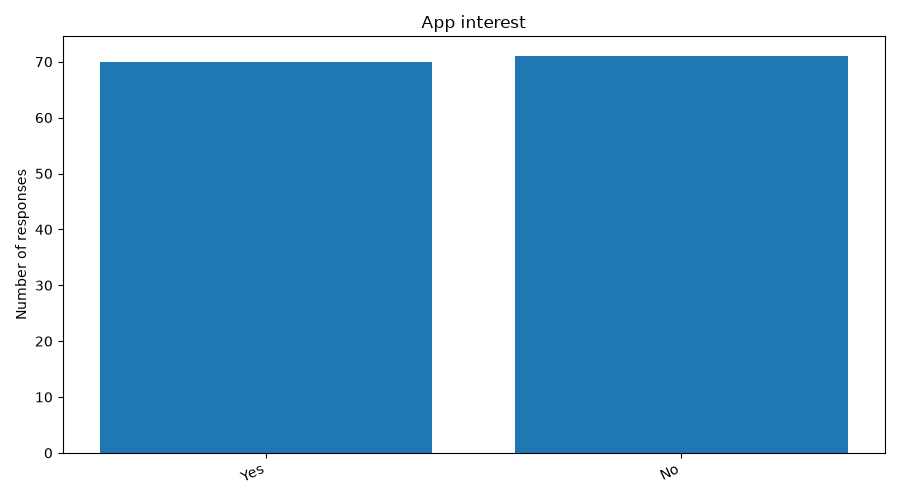
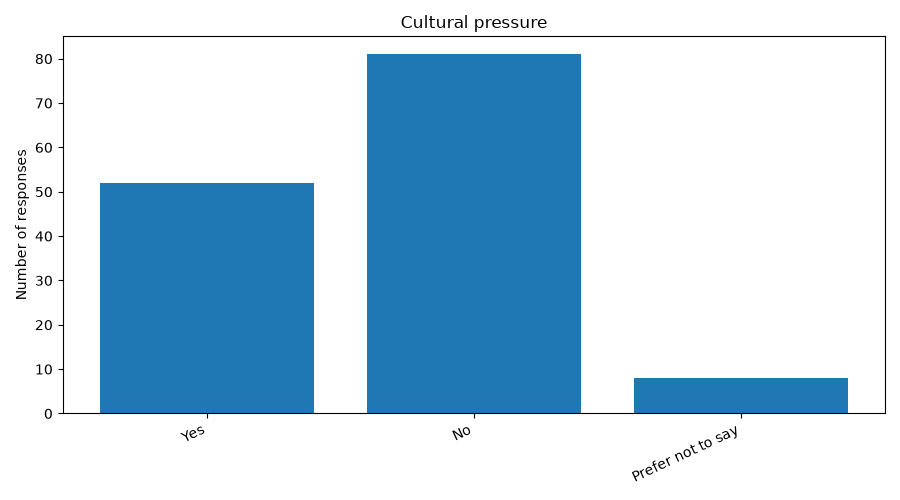
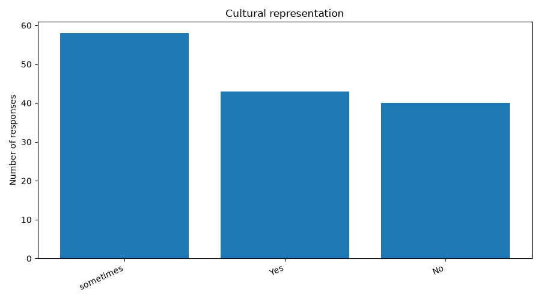
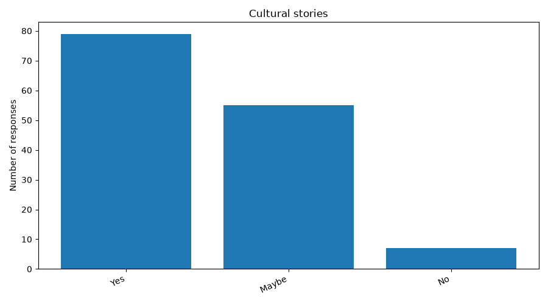
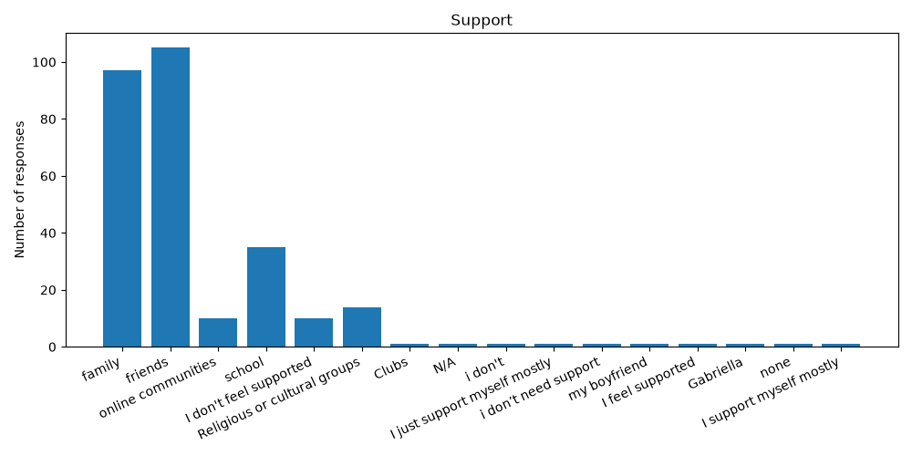

# ReConnectSphere Survey Analyser

## Overview
A beginner Python project developed as part of my
ReConnectSphere CREST Gold project.

The analyser is designed to explore anonymised
questionnaire responses and identify patterns
in the experiences of young people who have
recently moved to the UK.

## Project aims
- Organise survey response data.
- Analyse responses to identify common patterns.
- Summarise findings to support user research.
- Produce an output report.

## Technologies
- Python
- CSV data handling

## Skills developed
- Python programming
- Data analysis
- Problem-solving
- Understanding user research
- Interpreting survey findings

## Privacy
The project is intended for anonymised survey
data. No personally identifiable information
should be included in uploaded datasets.

## Project context
This project supports the research behind
ReConnectSphere, a digital support website
designed for young people who have recently
moved to the UK.

## How it works

The programme uses Python's CSV module to
load questionnaire responses.

It then uses Counter from Python's collections
module to count repeated answers and calculate
the percentage of responses for each answer.

The results are saved in a text file named
analysis_report.txt.

## Project structure

ReConnectSphere-Survey-Analyser/
│
├── README.md
├── survey_analyser.py
├── example_responses.csv
└── analysis_report.txt

## Future improvements

- Add graphical visualisations.
- Compare responses across different questions.
- Improve the analysis of qualitative responses.

## Survey Research Visualisations

The following charts illustrate key findings from the
research conducted for ReConnectSphere.

### Interest in an App

### Cultural Pressure

### Cultural Representation

### Cultural Stories

### Sources of Support

## Running the analyser

1. Download or clone this repository.
2. Ensure Python is installed.
3. Run:

python survey_analyser.py

4. Enter the CSV filename when prompted.
5. Open analysis_report.txt to view the results.

## Project development and testing

The analyser was developed using Python's CSV module
and Counter from the collections library.

The project includes an example CSV dataset to
demonstrate the expected input format and a sample
analysis report showing the intended output.

The programme was structured into separate functions
for loading responses, analysing answer patterns and
saving results.

## Limitations

- The analyser counts matching answers but does not
  interpret the meaning of longer written responses.
- Results depend on the quality and completeness
  of the supplied CSV data.
- The example dataset is illustrative and should not
  be treated as the original research dataset.

## Future development

- Introduce graphical data visualisations.
- Analyse written responses using text-processing methods.
- Compare patterns between different questionnaire groups.
- Improve the reporting of incomplete responses.
